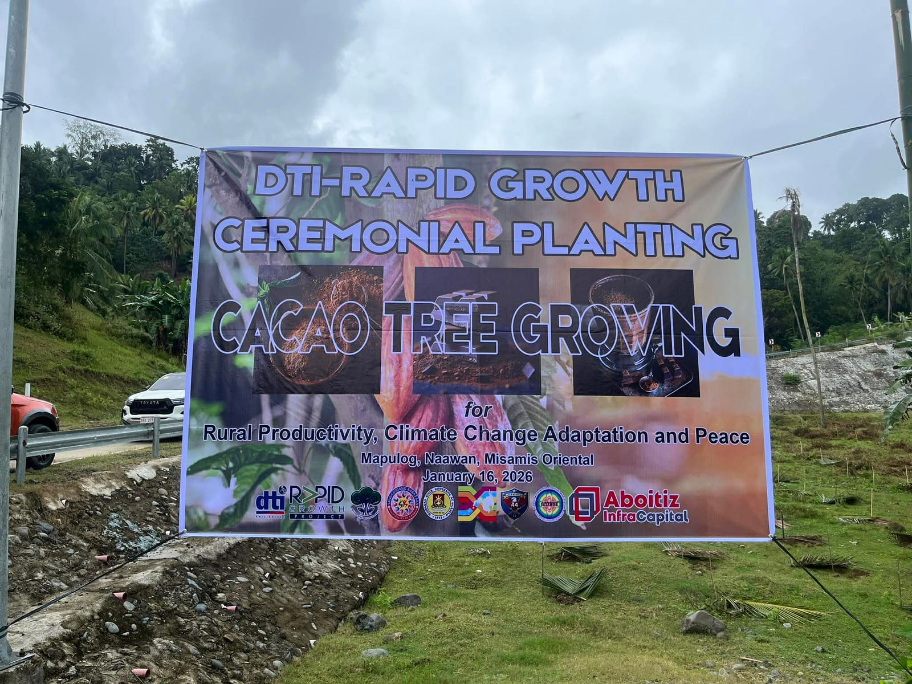
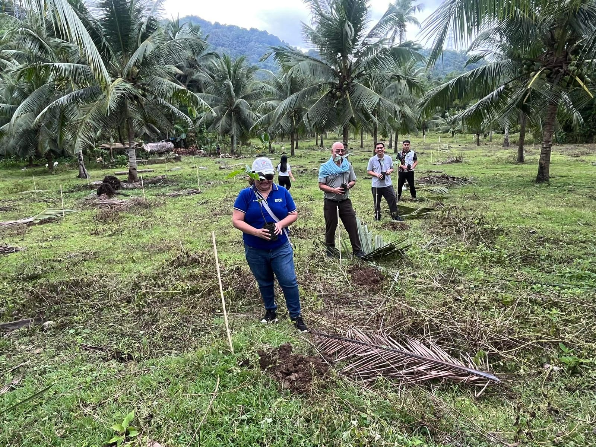
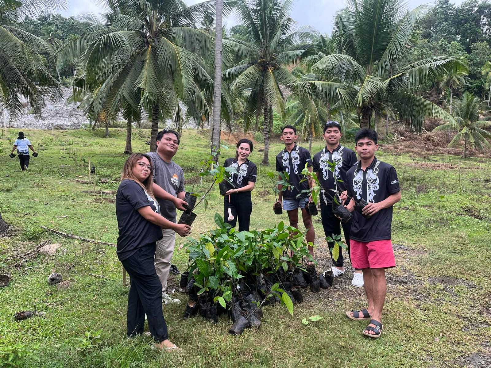

**Naawan, Misamis Oriental | 16 January 2026** — The Department of Trade and Industry–Misamis Oriental (DTI–MisOr) participated in the Ceremonial Cacao Tree Planting and Cacao Stakeholders’ Meeting held in Barangay Mapulog, Naawan, Misamis Oriental. The activity was initiated and organized by the Local Government Unit (LGU) of Naawan as part of its efforts to strengthen the local cacao industry and promote sustainable agricultural development.

The event was attended by key representatives from the Mindanao Development Authority (MinDA), Mindanao State University (MSU)–Naawan, Aboitiz InfraCapital, Ecosystems Work for Essential Benefits, Inc. (ECOWEB), the Philippine Army, the Sangguniang Kabataan, the Toburan–Mapulog–Maputi ARC Marketing Cooperative (TOMAMA), and various municipal offices, including the Municipal Agriculture Office.

The activity was a direct outcome of the matching grant provided by the DTI RAPID Growth Project to TOMAMA ARC Marketing Cooperative. Under this grant, a total of 30,000 cacao seedlings valued at PHP 1,050,000 and 125 bags of fertilizer worth PHP 200,000 were awarded to support the expansion of cacao production in the area. In support of this initiative, the LGU of Naawan committed an additional PHP 600,000 in planting assistance to help ensure successful farm establishment.

The ceremonial tree planting was led by Mayor Dennis Roa and symbolized the collective commitment of stakeholders to the development of the cacao industry in Naawan. This was followed by a stakeholders’ meeting that discussed key strategies for industry development, farm productivity enhancement, and the strengthening of market linkages with institutional and volume buyers.

The initiative underscored the importance of multi-sectoral collaboration among government agencies, academe, the private sector, civil society organizations, and the youth sector in advancing inclusive and sustainable economic growth. Through this joint effort, the activity aims to improve farmer incomes, enhance cacao value chain competitiveness, and contribute to local economic development in Misamis Oriental.

