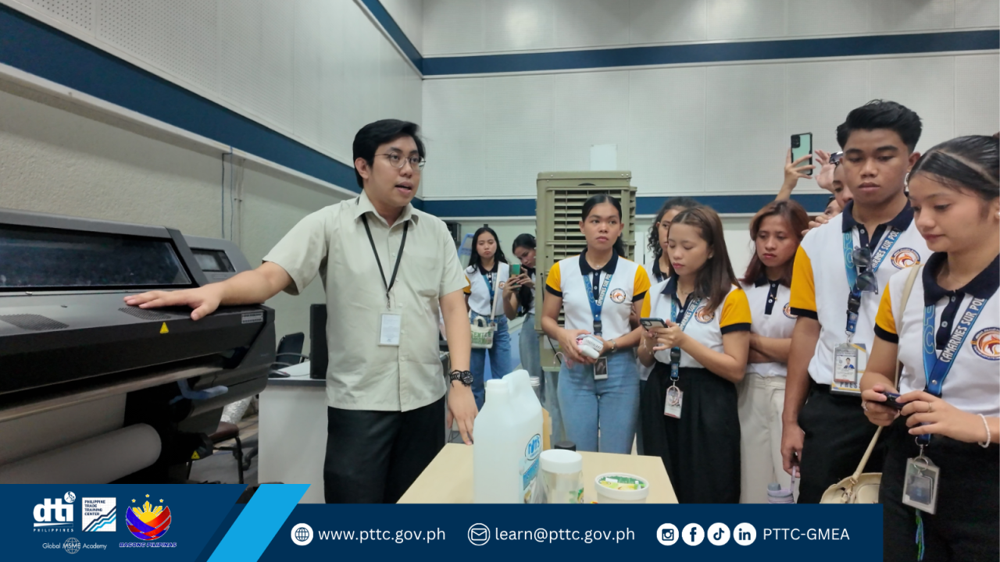

The Department of Trade and Industry (DTI)-RAPID Growth Project has taken another step toward strengthening youth participation in agriculture and entrepreneurship through the **Youth Champions’ Cascading Session for PCU Bukidnon Youth Hubs**, held on August 10–11, 2026, in Maramag, Bukidnon.

The two-day activity brought together **43 youth leaders from various municipalities across the province**, marking the first of four target batches under the initiative. The sessions were designed to equip young participants with practical knowledge and digital skills that can support innovation, entrepreneurship, and greater youth engagement in the agricultural sector.

Through hands-on learning sessions, participants were introduced to **value chain analysis, practical AI collaboration, and geotagging for smart farm management**. These tools are intended to help young people better understand agricultural value chains, explore technology-driven solutions, and identify opportunities for agri-enterprise development in their communities.

Beyond technical competencies, the activity also encouraged participants to consider agriculture not only as a livelihood but as a potential space for **innovation, entrepreneurship, and career development**. The youth champions were also introduced to **Basic Entrepreneurial Competencies and Google Career Certificates**, providing them with additional learning pathways to strengthen their skills for future employment and business opportunities.

The activity was conducted in collaboration with the **Negosyo Center Program**, with technical guidance and support from the NCBC team—Ms. Glaiza A. Caralde, Mr. Darnel Ivornel R. Cantilla, and Ms. Philline Labadan. The **Local Government Unit of Maramag** also supported the activity by providing the venue for the two-day session.

As the first of four planned batches, the activity lays the groundwork for building a wider network of **youth champions across Bukidnon** who can cascade their learning and encourage other young people to explore opportunities in agriculture, entrepreneurship, and digital innovation.

Through this initiative, the DTI-RAPID Growth Project continues to invest in young people as partners in building more innovative, inclusive, and sustainable agricultural value chains in Bukidnon.
